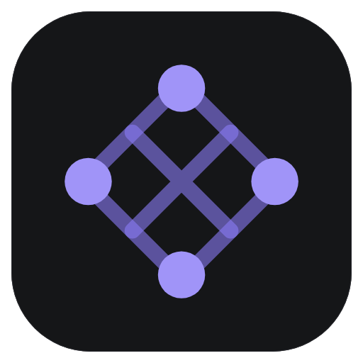
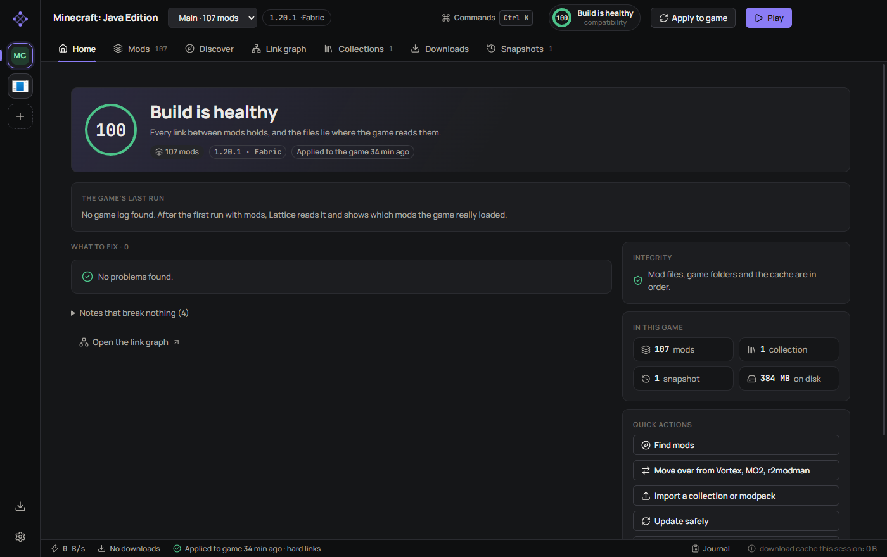
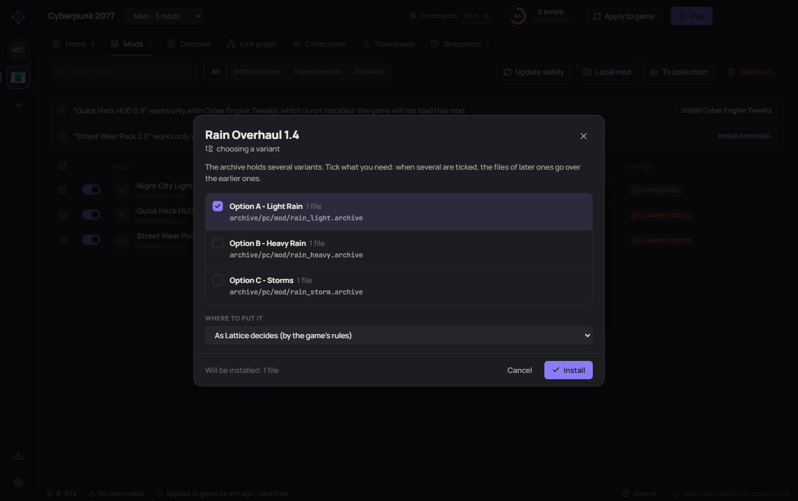
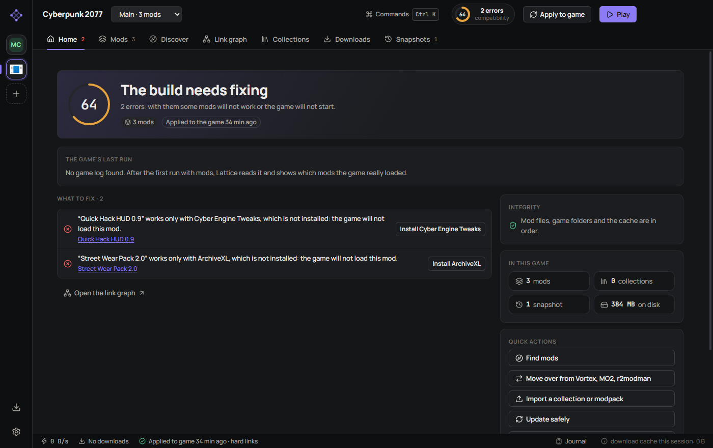
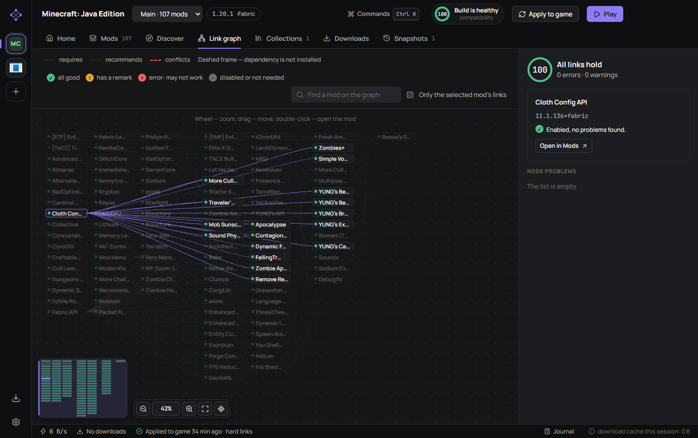
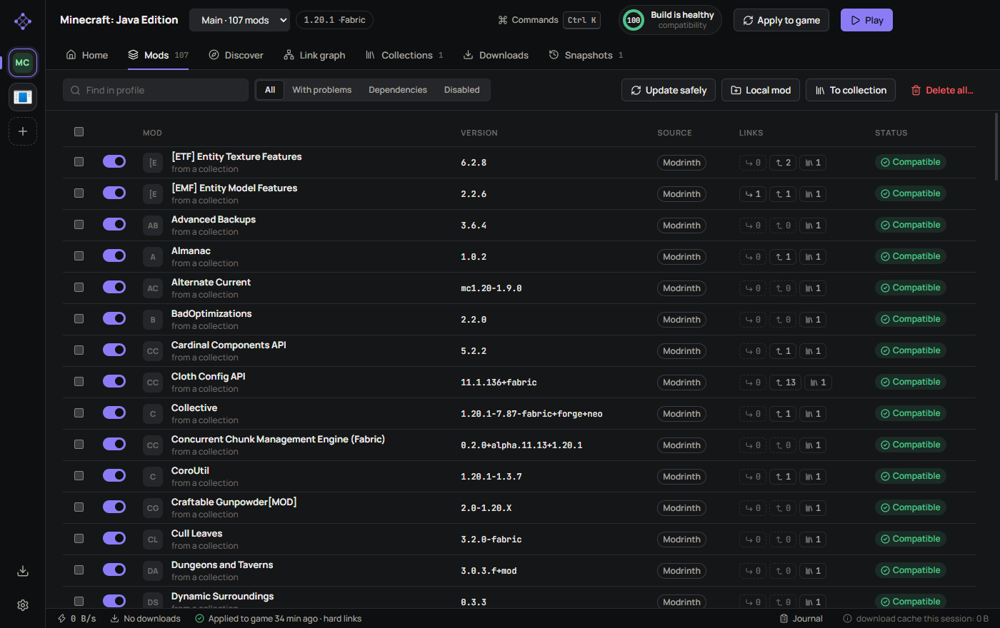
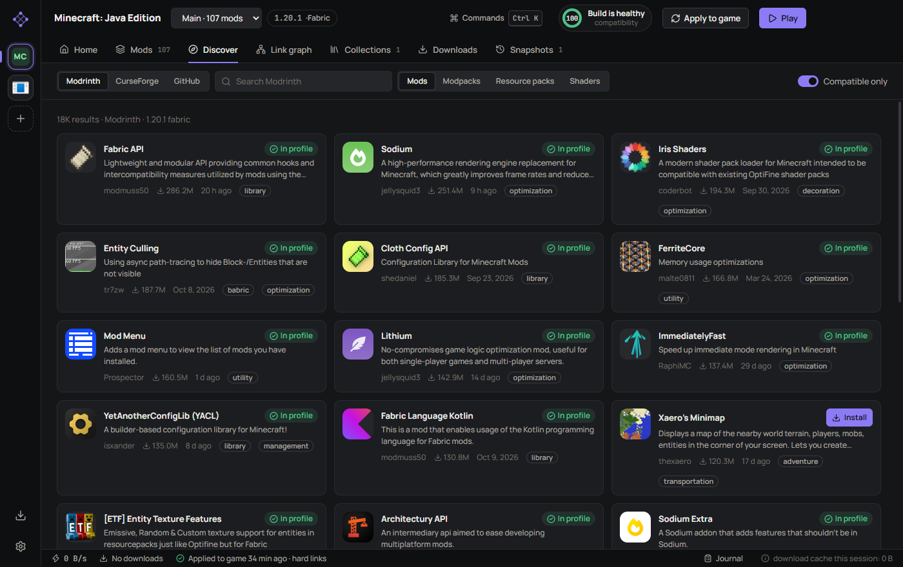
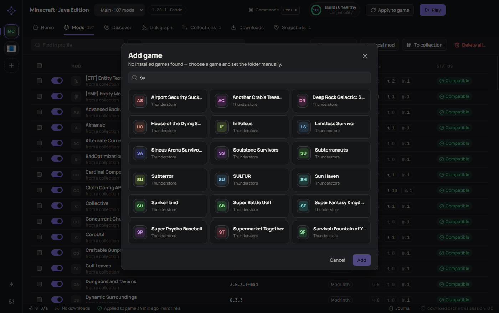
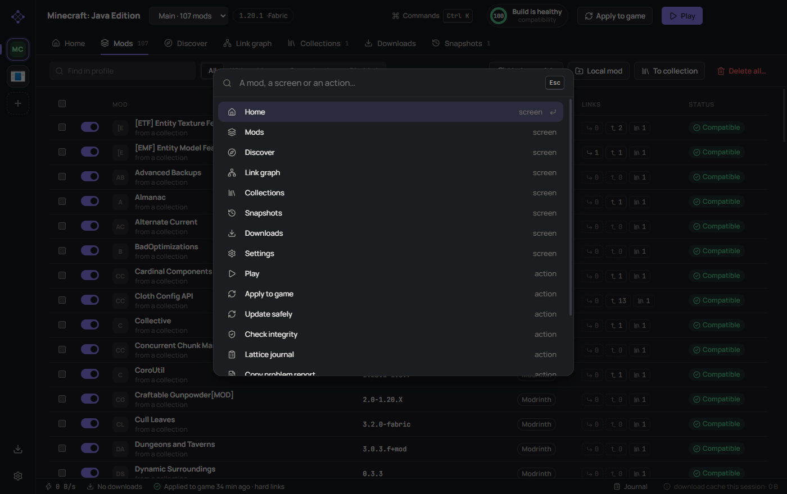
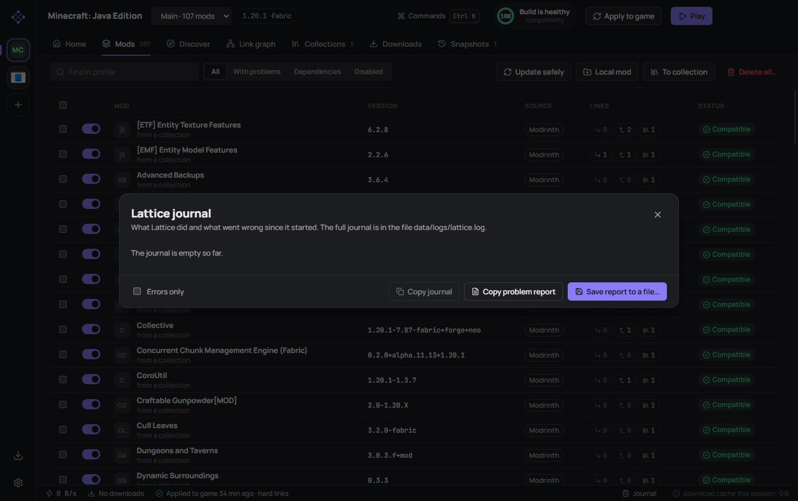

<p align="center"></p>

<h1 align="center">Lattice</h1>

<p align="center">
A mod manager for Windows that cares less about a mod being “installed”<br>
and more about it actually <b>working</b>.
</p>

<p align="center">
<a href="https://github.com/W1MR1/lattice-mod-manager/releases/latest"><b>Download</b></a> ·
<a href="docs/GUIDE.md">Guide (Russian)</a> ·
<a href="docs/SOURCES.md">Where mods come from (Russian)</a> ·
<a href="README.md">Русский</a>
</p>



## Why another mod manager

You know how it goes. Twenty mods installed, the game starts, half of them do
nothing, and there is no telling which half. The manager insists everything is
installed.

It is usually one of three things. The mod was unpacked into a folder the game
never looks in. The mod needs a framework nobody installed. Or the mod was built
for another version of the game. Lattice checks all three — before you start
the game, from the mod files themselves, and after, from the game's own log.
Then it tells you in plain words, with a “fix” button next to it.

## What it does

### Puts files where the game reads them

Authors pack mods any way they like: inside an extra folder, as loose files,
three variants in one archive. Lattice looks inside and lays the files out by
the game's rules. If the archive offers a choice, it asks. If the archive makes
no sense, it asks too — it does not guess. FOMOD installers run as a wizard,
pictures included.



### Tells you what a mod is missing

A Cyber Engine Tweaks script needs Cyber Engine Tweaks. An SKSE plugin needs
SKSE. Lattice sees that in the mod's files and offers to install what is
missing with one button. For Minecraft it reads the jars themselves: which
loader, which game version, which dependencies are really required.



### Checks against the game's log

After the game has run, Lattice reads the loader's log (Fabric, Forge, BepInEx,
SMAPI, RED4ext, SKSE and others) and shows which mods the game really loaded,
which it rejected, and why.

### Keeps the build whole

Every mod has links: “requires”, “recommends”, “conflicts with”. Before any
change Lattice picks versions so that everything fits and shows you the plan.
Before applying it takes a snapshot, so any change rolls back with one button.



### And also

- **Collections** — a build with exact versions and chosen variants; installs on
  another computer without questions. Imports Modrinth modpacks (`.mrpack`),
  Nexus Collections and Thunderstore modpacks.
- **Moving over from Vortex, Mod Organizer 2 and r2modman** — without
  downloading anything twice.
- **Nexus without Premium** — Lattice opens the right pages and picks the
  downloaded files up from your downloads folder.
- **Removal without traces** — with the mod's settings and the dependencies
  nothing else needs.
- **Journal and problem report** — one button, no keys and no user name in it.
- **Ctrl+K** — jump to any mod, screen or action.
- **Six languages** — English, 简体中文, Русский, Español, Português (Brasil), Deutsch.

<details>
<summary>More screenshots</summary>







</details>

## Games

| | |
|---|---|
| **Minecraft: Java Edition** | Fabric, Quilt, Forge, NeoForge; every popular launcher |
| **Skyrim Special Edition, Fallout 4** | FOMOD, plugin order, SKSE / F4SE |
| **Cyberpunk 2077** | RED4ext, Cyber Engine Tweaks, redscript, ArchiveXL, TweakXL |
| **Stardew Valley** | SMAPI, dependencies from `manifest.json` |
| **266 BepInEx games** | Lethal Company, R.E.P.O., PEAK, Valheim, Risk of Rain 2, Among Us, Hollow Knight: Silksong, Dyson Sphere Program, Inscryption… — everything with a Thunderstore catalogue and the standard install |

Lattice finds games from Steam, GOG, Epic and Xbox by itself.

## Getting started

1. Download `Lattice-Setup-…exe` from the [releases page](https://github.com/W1MR1/lattice-mod-manager/releases/latest)
   and install it. Windows SmartScreen will warn you: the installer is not
   signed (a certificate costs money the project does not have). “More info” →
   “Run anyway”.
2. Add a game. Lattice shows the copies it has found.
3. Find mods in Discover, or drop an archive onto the window.
4. Press **Play**. After the game has run, look at Home: it shows what the game
   loaded.

From then on Lattice updates itself and asks before every update.

## Where mods come from

Modrinth, CurseForge, Thunderstore, Nexus Mods, GitHub Releases, GameBanana and
files from disk. Only sites where the mod was published by its author and where
the file can be checked.

There are no torrents, no Nexus “mirrors” and no re-upload sites in Lattice, and
there will not be: a file from there cannot be verified, and that is the most
common way to get someone else's program along with a mod. The details, with
examples and links, are in [SOURCES.md](docs/SOURCES.md) (in Russian).

> [!CAUTION]
> **A personal Nexus Mods API key is at your own risk.**
> Lattice is not registered with Nexus Mods yet. Entering a key is **optional**:
> without one Lattice opens the mod pages and picks the downloaded files up from
> your downloads folder. If you do enter a personal key, know this: the
> [Nexus API policy](https://help.nexusmods.com/article/114-api-acceptable-use-policy)
> does not allow personal keys in public applications. Nexus may revoke the key,
> or restrict or ban the account.
>
> **The author of Lattice bears no responsibility** for what follows from using a
> personal key: a ban, loss of access, account restrictions or anything else. By
> entering a key you take that risk yourself. The program is provided “as is”,
> without any warranty (see [LICENSE](LICENSE), sections 15–16).
>
> Modrinth, Thunderstore and GitHub work without keys, and this risk does not
> concern them.

## What Lattice cannot do

Better to learn it here than after installing.

- **Windows only.**
- **Archive layouts are verified on samples,** not on a live Cyberpunk 2077 or
  Skyrim: the author does not have them at hand. Log parsing is checked against
  the source code of the loaders themselves (Fabric, BepInEx, SMAPI, RED4ext,
  Cyber Engine Tweaks, SKSE), but not against a live game either. If Lattice
  gets something wrong, send a problem report — it gets fixed quickly.
- **Of the 266 BepInEx games, installing was verified live on eight.** The rest
  install by the same rules from Thunderstore's registry.
- **No LOOT-style plugin sorting.** The order comes from the mods themselves and
  from your “before/after” rules.
- **Nexus speed without Premium** is limited by Nexus. Lattice does not go
  around it.
- **Translations were made by AI** and not proofread by native speakers. Fixes
  are welcome.
- **The installer is large** (about 115 MB): Chromium is inside. The reasons are
  in the [decision record](docs/adr/0001-electron-or-rust.md) (in Russian).

## When something does not work

Home → “Copy problem report” → paste it into a
[new issue](https://github.com/W1MR1/lattice-mod-manager/issues/new). The report
holds versions, the list of problems, the game's log and Lattice's journal. No
keys, no user name and no download links — a test makes sure of that.

## For developers

```bash
npm install
```

```bash
npm run dev
```

Electron, React, TypeScript. The core does not depend on Electron and is covered
by 173 tests. The developer documentation is in Russian:

- [Development](docs/DEVELOPMENT.md) — commands, structure, how to add a game
- [How it is tested](docs/TESTING.md) · [Release checklist](docs/RELEASE-CHECKLIST.md)
- [Technical debt](docs/TECH-DEBT.md) · [Why not Rust](docs/adr/0001-electron-or-rust.md)

## License

[GPL-3.0](LICENSE). Lattice is not affiliated with Nexus Mods, Modrinth,
CurseForge, Thunderstore, Mojang or any game publisher; all names belong to
their owners.
