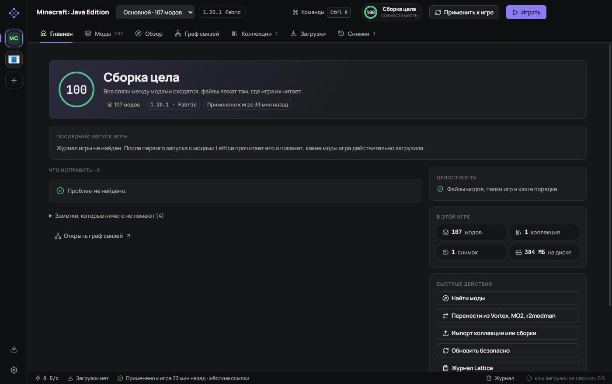
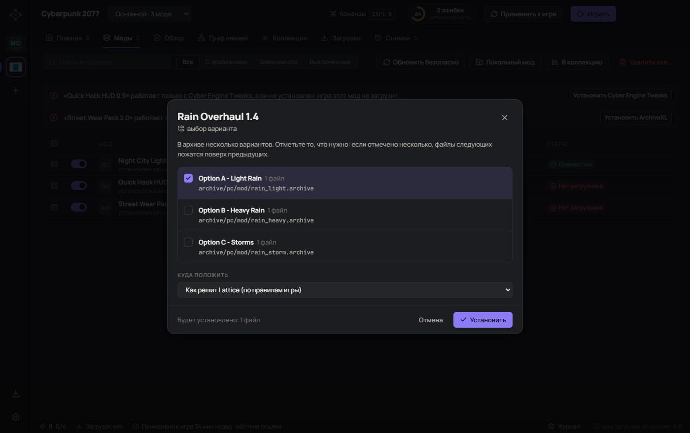
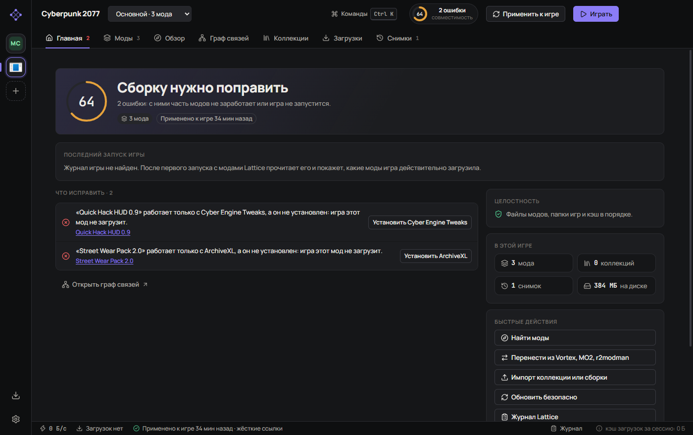
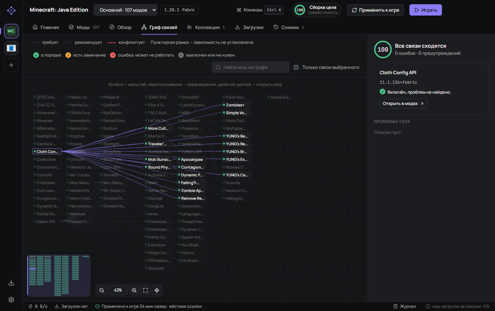
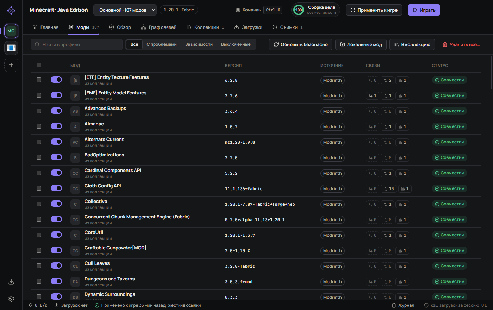
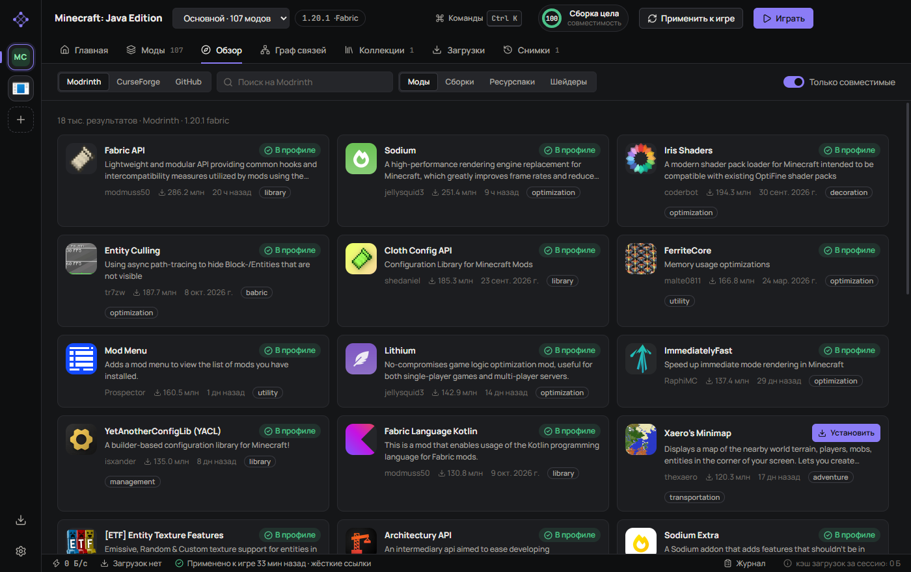
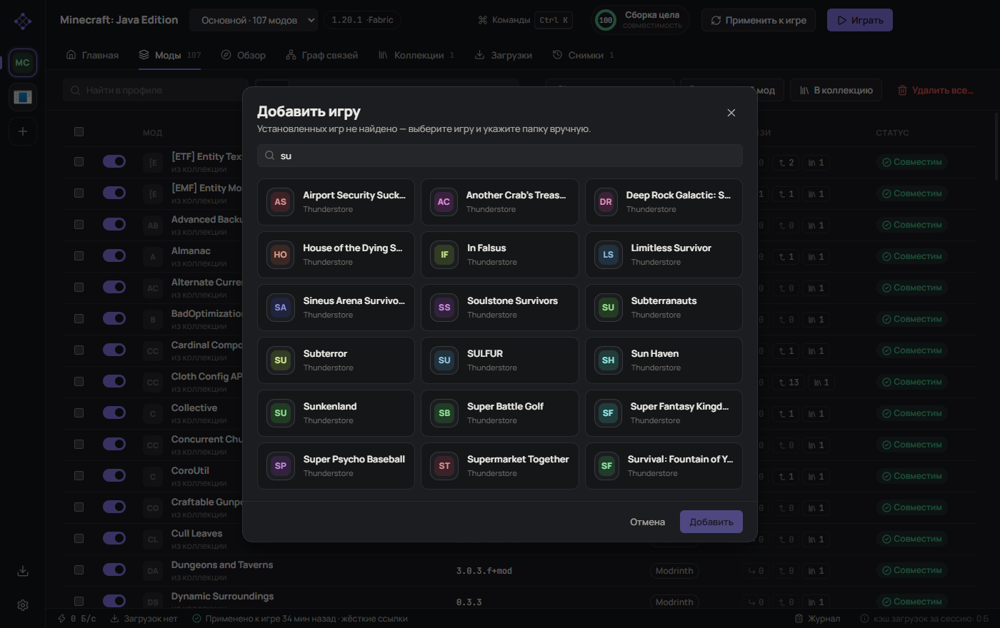
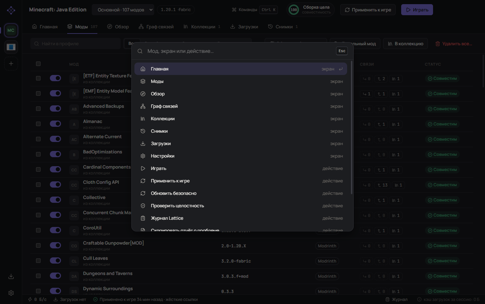
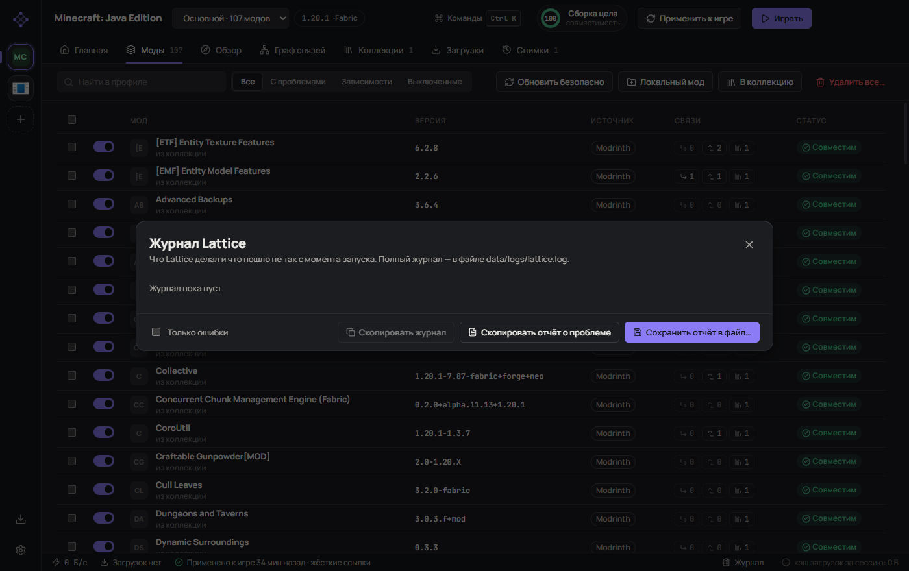

<p align="center"></p>

<h1 align="center">Lattice</h1>

<p align="center">
Менеджер модов для Windows, который следит не за тем, чтобы мод был «установлен»,<br>
а за тем, чтобы он <b>работал</b>.
</p>

<p align="center">
<a href="https://github.com/W1MR1/lattice-mod-manager/releases/latest"><b>Скачать</b></a> ·
<a href="docs/GUIDE.md">Руководство</a> ·
<a href="docs/SOURCES.md">Откуда моды</a> ·
<a href="README.en.md">English</a>
</p>



## Зачем ещё один менеджер модов

Знакомая история: поставил двадцать модов, запустил игру, половина не работает,
и непонятно какая. Менеджер при этом уверяет, что всё установлено.

Обычно причина одна из трёх. Мод распаковался не в ту папку, где игра его ищет.
Моду нужна основа, которую никто не поставил. Или мод собран для другой версии
игры. Lattice проверяет все три — до запуска, по самим файлам модов, и после
запуска, по журналу игры. И говорит об этом человеческими словами, с кнопкой
«исправить» рядом.

## Что он делает

### Кладёт файлы туда, где их читает игра

Авторы пакуют моды как придётся: в лишней папке, россыпью, с тремя вариантами
на выбор в одном архиве. Lattice заглядывает внутрь и раскладывает файлы по
правилам игры. Если в архиве есть выбор, он спросит. Если архив непонятен —
тоже спросит, а не угадает. Установщики FOMOD проходят мастером, с картинками.



### Говорит, чего моду не хватает

Скрипту для Cyber Engine Tweaks нужен сам Cyber Engine Tweaks. Плагину SKSE —
SKSE. Lattice видит это по файлам мода и предлагает поставить недостающее одной
кнопкой. Для Minecraft он читает сами jar: какой загрузчик, какая версия игры,
какие зависимости на самом деле нужны.



### Проверяет по журналу игры

После запуска Lattice читает журнал загрузчика (Fabric, Forge, BepInEx, SMAPI,
RED4ext, SKSE и другие) и показывает, какие моды игра действительно загрузила,
а какие отвергла и почему.

### Держит сборку целой

У каждого мода есть связи: «требует», «рекомендует», «несовместим». Перед любым
изменением Lattice подбирает версии так, чтобы всё сошлось, и показывает план.
Перед применением делает снимок: любое изменение откатывается одной кнопкой.



### И ещё

- **Коллекции** — сборка с точными версиями и выбранными вариантами; ставится
  на другом компьютере без вопросов. Импорт сборок Modrinth (`.mrpack`),
  Nexus Collections и модпаков Thunderstore.
- **Перенос из Vortex, Mod Organizer 2 и r2modman** — без повторного скачивания.
- **Nexus без Premium** — Lattice открывает нужные страницы и сам забирает
  скачанное из папки загрузок.
- **Удаление без следов** — вместе с настройками мода и ненужными зависимостями.
- **Журнал и отчёт о проблеме** — одной кнопкой, без ключей и имени пользователя.
- **Ctrl+K** — быстрый переход к любому моду, экрану или действию.
- **Шесть языков** — English, 简体中文, Русский, Español, Português (Brasil), Deutsch.

Полный список — в [руководстве](docs/GUIDE.md#что-умеет).

<details>
<summary>Ещё снимки экранов</summary>







</details>

## Игры

| | |
|---|---|
| **Minecraft: Java Edition** | Fabric, Quilt, Forge, NeoForge; все популярные лаунчеры |
| **Skyrim Special Edition, Fallout 4** | FOMOD, порядок плагинов, SKSE / F4SE |
| **Cyberpunk 2077** | RED4ext, Cyber Engine Tweaks, redscript, ArchiveXL, TweakXL |
| **Stardew Valley** | SMAPI, зависимости из `manifest.json` |
| **266 игр на BepInEx** | Lethal Company, R.E.P.O., PEAK, Valheim, Risk of Rain 2, Among Us, Hollow Knight: Silksong, Dyson Sphere Program, Inscryption… — всё, для чего есть каталог на Thunderstore со стандартной установкой |

Игры из Steam, GOG, Epic и Xbox Lattice находит сам.

## Начать

1. Скачайте `Lattice-Setup-…exe` со [страницы выпусков](https://github.com/W1MR1/lattice-mod-manager/releases/latest)
   и установите. Windows SmartScreen предупредит: установщик не подписан
   (сертификат стоит денег, которых у проекта нет). «Подробнее» → «Выполнить в
   любом случае».
2. Добавьте игру. Найденные копии Lattice покажет сам.
3. Найдите моды в «Обзоре» или перетащите архив в окно.
4. Нажмите **«Играть»**. После запуска загляните на «Главную»: там будет видно,
   что игра загрузила.

Дальше Lattice обновляется сам и спрашивает перед каждым обновлением.

## Откуда моды

Modrinth, CurseForge, Thunderstore, Nexus Mods, GitHub Releases, GameBanana и
файлы с диска. Только сайты, куда мод выложил сам автор и где файл можно
проверить.

Торрентов, «зеркал» Nexus и сайтов-перезаливов в Lattice нет и не будет: файл
оттуда нечем проверить, и это самый частый способ получить вместе с модом
чужую программу. Подробно, с примерами и ссылками — в [SOURCES.md](docs/SOURCES.md).

> [!CAUTION]
> **Личный API-ключ Nexus Mods — на ваш страх и риск.**
> Lattice пока не зарегистрирован в Nexus Mods. Вводить ключ **необязательно**:
> без него Lattice открывает страницы модов, а скачанное забирает из папки
> загрузок. Если вы всё же вводите личный ключ, знайте:
> [правила API Nexus](https://help.nexusmods.com/article/114-api-acceptable-use-policy)
> не разрешают использовать личные ключи в публичных приложениях. Nexus может
> отозвать ключ, ограничить или заблокировать аккаунт.
>
> **Автор Lattice не несёт никакой ответственности** за последствия использования
> личного ключа: блокировку, потерю доступа, ограничения аккаунта и любые другие.
> Вводя ключ, вы принимаете этот риск сами. Программа распространяется «как есть»,
> без каких-либо гарантий (см. [LICENSE](LICENSE), разделы 15–16).
>
> Modrinth, Thunderstore и GitHub работают без ключей, и этот риск их не касается.

## Чего Lattice не умеет

Лучше узнать это здесь, чем после установки.

- **Только Windows.**
- **Раскладка архивов и разбор журналов проверены на образцах,** а не на живых
  Cyberpunk 2077 и Skyrim: у автора их нет под рукой. Если Lattice разложил мод
  не так — пришлите отчёт о проблеме, это исправляется быстро.
- **Из 266 игр на BepInEx установка проверена вживую на восьми.** Остальные
  ставятся по тем же правилам из реестра Thunderstore.
- **Нет сортировки плагинов в духе LOOT.** Порядок задают сами моды и ваши
  правила «до/после».
- **Скорость Nexus без Premium** ограничивает сам Nexus. Lattice это не обходит.
- **Переводы сделал ИИ,** носители их не вычитывали. Исправления приветствуются.
- **Установщик большой** (около 115 МБ): внутри Chromium. Почему так — в
  [записи о решении](docs/adr/0001-electron-or-rust.md).

Полный список — в [руководстве](docs/GUIDE.md#ограничения).

## Если что-то не работает

«Главная» → «Скопировать отчёт о проблеме» → вставьте в
[новое сообщение об ошибке](https://github.com/W1MR1/lattice-mod-manager/issues/new).
В отчёте версии, список проблем, журнал игры и журнал Lattice. Ключей, имени
пользователя и ссылок на скачивание в нём нет — это проверяется тестом.

## Для разработчиков

```bash
npm install
```

```bash
npm run dev
```

Electron, React, TypeScript. Ядро не зависит от Electron и покрыто 153 тестами.

- [Разработка](docs/DEVELOPMENT.md) — команды, устройство, как добавить игру
- [Как проверяется](docs/TESTING.md) · [Список перед выпуском](docs/RELEASE-CHECKLIST.md)
- [Технический долг](docs/TECH-DEBT.md) · [Почему не Rust](docs/adr/0001-electron-or-rust.md)
- [Дизайн-система](docs/DESIGN-SYSTEM.md) · [Разбор Vortex](docs/RESEARCH.md)

## Лицензия

[GPL-3.0](LICENSE). Lattice не связан с Nexus Mods, Modrinth, CurseForge,
Thunderstore, Mojang и издателями игр; все названия принадлежат их владельцам.
