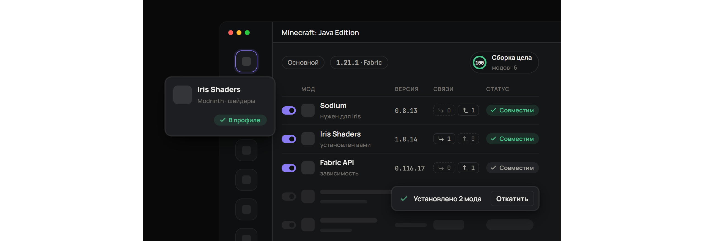

# Lattice — менеджер модов и коллекций

> **English:** Lattice is a mod and collection manager for Windows (Minecraft,
> BepInEx games, Skyrim SE, Fallout 4, Cyberpunk 2077, Stardew Valley). Every
> mod and collection is linked by dependencies, so installs and updates never
> break a build. The app speaks English, 简体中文, Русский, Español,
> Português (Brasil) and Deutsch: pick the language in the installer and change
> it any time in Settings → Appearance → Language.



Десктопное приложение (Electron + React) в духе Vortex, но со своим дизайном и
тремя главными отличиями:

1. **Всё связано.** У каждого мода есть связи «требует», «рекомендует»,
   «несовместим», «до/после». У плагина Bethesda есть связи с мастер-файлами.
   У каждой коллекции есть связи «строится поверх» (с диапазоном версий) и
   «несовместима с». Перед любым изменением решатель подбирает версии так,
   чтобы сходились все связи, игра и загрузчик. Изменение показывается планом,
   а перед применением делается снимок, который откатывается одной кнопкой.
2. **Многопоточные загрузки там, где источник это разрешает.** У самого
   Lattice нет искусственного троттлинга. Если сервер поддерживает HTTP Range,
   файл делится на части и качается параллельно, освободившийся поток забирает
   половину самого большого остатка. Правила источников соблюдаются: например,
   файлы Nexus Mods без Premium качаются в один поток через «Mod Manager
   Download», их серверное ограничение Lattice не обходит. Поддерживаются
   пауза, докачка и проверка sha512/sha256/sha1.
3. **Только безопасные источники.** Modrinth, Thunderstore, Nexus Mods (через
   официальный API), GitHub Releases и локальные файлы. Только HTTPS и домены
   из списка доверенных, защита от zip-slip, предупреждение об исполняемых
   файлах в архивах, резервные копии перезаписанных файлов игры.

> [!CAUTION]
> **Личный API-ключ Nexus Mods — на ваш страх и риск.**
> Пока Lattice не зарегистрирован в Nexus Mods, скачивание с Nexus работает только
> через ваш личный API-ключ. [Правила API Nexus](https://help.nexusmods.com/article/114-api-acceptable-use-policy)
> не разрешают использовать личные ключи в публичных приложениях. Nexus может
> отозвать ключ, ограничить или заблокировать аккаунт.
>
> **Автор Lattice не несёт никакой ответственности** за последствия использования
> личного ключа: блокировку, потерю доступа, ограничения аккаунта и любые другие.
> Вводя ключ, вы принимаете этот риск сами. Программа распространяется «как есть»,
> без каких-либо гарантий (см. [LICENSE](LICENSE), разделы 15–16).
>
> Modrinth, Thunderstore и GitHub работают без ключей, и этот риск их не касается.

## Запуск

```bash
npm install
```

```bash
npm run dev
```

Другие команды:

| Команда | Что делает |
|---|---|
| `npm run build && npm start` | собрать и запустить без dev-сервера |
| `npm run dist` | собрать установщик Windows: `release/Lattice-Setup-<версия>.exe` |
| `npm test` | тесты движка: решатель, совместимость, загрузчик, архивы, FOMOD, plugins.txt, ссылки Nexus, удаление, переводы |
| `npm run i18n` | проверка переводов: каких строк не хватает в каждом языке (`-- --sources` — список всех строк с ключами) |
| `npm run typecheck` | проверка типов |
| `npm run smoke` | сквозная проверка во временном профиле: ставит моды с Modrinth, разворачивает их, проверяет связанные коллекции и снимает скриншоты экранов в `smoke/` (флаги `--fixes` — проверка при запуске, загрузчик Fabric, удаление без следов; `--thunderstore`, `--archives`, `--light`) |
| `npm run demo` | анимированный демо-ролик для сайта или README (`demo/`) |
| `npm run icon` | перерисовать иконку приложения `build/icon.png` |

Если после `npm install` нет `node_modules/electron/dist`, докачайте Electron:
`node node_modules/electron/install.js`.

Сборщику установщика NSIS нужен путь к проекту короче 260 символов. Если проект
лежит глубоко, соберите с временного диска: `subst L: "<папка проекта>"`, затем
`npm run dist` из `L:\`, потом `subst L: /d`.

## Публикация и Nexus Mods

Nexus не разрешает публичным приложениям работать на личных API-ключах
пользователей: приложение нужно зарегистрировать
([правила API](https://help.nexusmods.com/article/114-api-acceptable-use-policy)).
Порядок такой:

1. Соберите тестовую версию (`npm run dist`). В ней вход в Nexus работает через
   личный ключ: это разрешено для тестирования.
2. Напишите на support@nexusmods.com: приложите тестовую сборку, а лучше и
   ссылку на исходники. Если Nexus попросит что-то поменять, поменяйте.
3. Отправьте название, короткое описание и логотип (высокого разрешения,
   читаемый на тёмном фоне; подойдёт `build/icon.png`).
4. Nexus выдаст «slug» приложения. Соберите релиз с ним:

```bash
LATTICE_NEXUS_SLUG=ваш-slug npm run dist
```

В такой сборке в настройках вместо поля для ключа появится кнопка «Войти через
Nexus» (SSO, протокол 2): пользователь подтверждает доступ на сайте Nexus, и
Lattice получает ключ, не видя пароля. Ключ хранится только на компьютере
пользователя, зашифрованным, — хранить ключи на своём сервере Nexus запрещает.
В запросах к API уходят `Application-Name: Lattice` и
`Application-Version` из `package.json`; при выпуске новой версии поднимайте её там.

Пример для PowerShell: `$env:LATTICE_NEXUS_SLUG="ваш-slug"; npm run dist`.

**CurseForge** работает так же: ключ API выдаёт сам CurseForge
(console.curseforge.com). Сборка с ключом — `LATTICE_CURSEFORGE_KEY=ключ npm run dist`;
без него пользователь может указать свой ключ в настройках.

## Как играть с модами

1. Добавьте игру. Lattice ищет её копии в Steam, GOG, Epic и Xbox, а для
   Minecraft — папки всех лаунчеров: официального, Prism, MultiMC, Legacy
   Launcher, TLauncher, CurseForge, Modrinth App и ATLauncher, вместе с версией
   и загрузчиком каждого экземпляра. Выберите копию, через которую вы играете:
   моды попадут именно в её папку.
2. Поставьте моды из «Обзора», коллекции или просто перетащите файлы в окно.
3. Нажмите **«Играть»** в шапке. Lattice применит моды и запустит игру так, как
   умеет её лаунчер:
   - **Prism Launcher и MultiMC:** экземпляр запускается сразу, без лишних
     действий (`--launch`).
   - **Legacy Launcher (версия 159+):** Lattice ставит Fabric или Quilt в его
     папку и запускает нужную версию (`--version … --launch`). Режим отдельных
     папок версий (`home/<версия>`) поддерживается: выберите такую папку при
     добавлении игры.
   - **Официальный лаунчер:** Lattice ставит Fabric/Quilt под версию профиля и
     добавляет профиль «Lattice · имя профиля» (с отдельной папкой игры, если
     она отдельная); в лаунчере остаётся нажать «Играть». Forge и NeoForge
     ставятся только своими официальными установщиками.
   - **TLauncher, CurseForge, Modrinth App, ATLauncher:** моды лежат в папке
     экземпляра, Lattice открывает лаунчер.
   - **Skyrim SE и Fallout 4:** через SKSE/F4SE, **Stardew Valley** — через SMAPI,
     если они установлены. Остальные игры — через Steam, Epic Games или exe
     (GOG). Игры из Xbox/Game Pass запускаются через приложение Xbox.

Если в лаунчере сменили версию экземпляра, проверка при запуске это заметит и
предложит перенести версию в профиль Lattice.

**«Применить к игре»** (раньше «Развернуть») кладёт файлы включённых модов в
папку игры и убирает выключенные. Это происходит само после каждого изменения.
Кнопка нужна, если файлы в папке игры поменял кто-то другой. После применения
уведомление показывает, в какую папку легли моды.

## Частые вопросы

**Можно ли смешивать моды из разных коллекций и источников?** Да. Все моды
профиля, откуда бы они ни пришли, живут в одном графе, и проверка совместимости
видит их все. Связи «требует» источники объявляют сами: Modrinth ссылается на
Modrinth, Nexus на Nexus. Если зависимость пришла из другого источника, свяжите
моды вручную в карточке мода. Если один и тот же мод стоит дважды из разных
источников, Lattice предупредит и предложит выключить копию. Две коллекции,
которые ставят разные версии одного мода, решатель сведёт к одной или покажет
конфликт до установки.

**Где брать моды для Cyberpunk 2077, кроме Nexus?** Основа модовой сцены лежит
на GitHub: RED4ext, Cyber Engine Tweaks, redscript, ArchiveXL, TweakXL,
Codeware. Lattice показывает их в «Обзоре» → GitHub, когда поиск пуст, и знает,
что ArchiveXL, TweakXL и Codeware требуют RED4ext. Большинство остальных модов
публикуется только на Nexus.

## Что умеет

- **Языки:** English, 简体中文, Русский, Español, Português (Brasil), Deutsch —
  шесть самых распространённых языков игроков на ПК. Язык выбирается при
  установке, сменить его можно в любой момент: Настройки → Вид → Язык.

- **Игры:** Minecraft (Fabric/Quilt/Forge/NeoForge), Lethal Company, Valheim,
  Risk of Rain 2, Content Warning (BepInEx через Thunderstore), Skyrim SE,
  Fallout 4, Cyberpunk 2077, Stardew Valley. Игры находятся автоматически по
  библиотекам Steam.
- **Профили:** у каждого своя версия игры и загрузчик. При переключении игра
  пересобирается.
- **Моды:** установка с подтягиванием зависимостей, безопасное обновление
  (то, что сломает связи, остаётся на месте), свои связи для модов без
  метаданных, правила порядка «до/после».
- **Надёжная очистка папки игры:** если файл занят запущенной игрой, Lattice не
  бросает работу на полпути, а сообщает, какие файлы не удалось убрать, помнит
  их и уберёт при следующем применении; проверка при запуске напомнит об
  оставшихся. В режиме «без следов» видны и чужие файлы в папке модов (не от
  Lattice) — их можно удалить отдельно.
- **Удаление:** одного мода, отмеченных или всех сразу. Можно удалить мод вместе
  с зависимостями, которые больше никому не нужны, или только его. Если без мода
  перестанут работать другие, Lattice покажет их и спросит, удалять ли и их.
  Режим **«Удалить без следов»** после удаления находит подготовленные копии,
  скачанные архивы и файлы настроек мода в папке игры (`config/` у Minecraft,
  `BepInEx/config` у BepInEx) и удаляет то, что вы отметите. Перед удалением
  всегда делается снимок.
- **Проверка при запуске:** пропавшие файлы модов в папке игры, повреждённые
  копии, недокачанные загрузки, циклы в правилах порядка, повреждённый файл
  настроек (берётся резервная копия). Lattice спрашивает: «Попытаться
  исправить» или «Оставить как есть». Проверку можно запустить и вручную:
  Настройки → Обслуживание.
- **Обновления приложения:** при запуске Lattice проверяет релизы на GitHub и
  спрашивает, обновляться ли. «Позже» — спросит при следующем запуске, «Не
  предлагать 7 дней» — отложит вопрос на неделю. Проверить вручную можно в
  Настройки → Обслуживание.
- **Источники:** Modrinth, CurseForge (по ключу API), Thunderstore, Nexus Mods,
  GameBanana и GitHub. Аккаунт Modrinth: по имени пользователя видны ваши
  публичные коллекции, с токеном — ещё приватные и подписки, всё можно поставить
  одной кнопкой. Кнопка «Другие источники» в карточке мода ищет тот же мод там,
  где нет ограничений скорости. GameBanana и CurseForge не дают входа через
  аккаунт сторонним программам.
- **Экспорт и резервная копия:** профиль сохраняется файлом коллекции (точные
  версии и хэши) и открывается на другом компьютере; вся библиотека Lattice —
  одним файлом в Настройки → Обслуживание (без ключей и файлов модов).
- **Офлайн:** если GitHub недоступен при запуске, Lattice сообщает об этом и
  работает дальше; в строке состояния виден значок «Офлайн».
- **Удобства:** иконки игр и лаунчеров берутся из их exe; загрузки и снимки
  показываются по текущей игре; Ctrl+F — поиск, Ctrl+1…6 — вкладки; лёгкие
  анимации (отключаются вместе с анимациями Windows).
- **GitHub:** поиск привязан к игре (ключевые слова игры в названии, описании
  и темах репозитория), для каждой игры отсеиваются сборки под macOS и Linux.
- **Архивы:** `.zip`, `.7z` (встроенный 7-Zip) и `.rar` (unrar на WebAssembly).
  Всё распаковывается во временную папку, каждый путь проверяется.
- **Установщики FOMOD:** мастер с шагами, группами и условиями, как в
  ModuleConfig.xml (включая UTF-16, флаги и зависимости от активных плагинов).
  Выбор сохраняется у мода и в коллекции, поэтому коллекция ставится без вопросов.
  Опции можно поменять позже кнопкой «Опции» в карточке мода.
- **Bethesda:** `plugins.txt` ведётся по порядку модов и правилам «до/после»,
  чужие записи остаются на месте, оригинал возвращается при очистке. Мастер-файлы
  читаются из заголовка TES4, и отсутствующий мастер — это ошибка совместимости.
- **Nexus Mods:** поиск, файлы и требования модов через открытый API (требования
  становятся связями «требует»). Для скачивания — вход «Войти через Nexus» (SSO)
  в зарегистрированной сборке или личный ключ в тестовой; ключ хранится
  зашифрованным хранилищем Windows. С Premium файлы качаются
  напрямую в несколько потоков, без Premium — кнопкой «Mod Manager Download» на
  сайте (ссылки `nxm://`) и одним потоком, по правилам Nexus.
- **Проверка по файлам модов (Minecraft):** Lattice читает `fabric.mod.json`,
  `quilt.mod.json` и `mods.toml` внутри каждого jar, включая встроенные в него
  моды, и до запуска показывает зависимость, без которой загрузчик не запустит
  игру, или явный конфликт («breaks»). Конфликт засчитывается, только если
  установленная версия действительно попадает в указанный диапазон.
- **Совместимость:** оценка 0–100, список проблем с кнопками исправления,
  граф связей, предупреждения, когда два мода пишут один файл и когда один мод
  стоит дважды из разных источников.
- **Коллекции:** создание из профиля (точные версии, хэши, правила, выбор FOMOD),
  связи между коллекциями, импорт `.mrpack` с привязкой файлов к проектам
  Modrinth по хэшу, экспорт и импорт `.lattice.json`, сверка и перезакрепление.
- **Развёртывание:** жёсткие ссылки (с откатом на копирование), манифест
  владения файлами, полная очистка с восстановлением оригиналов.
- **Снимки:** создаются сами перед каждым изменением. Откат — в разделе
  «Снимки» или кнопкой «Откатить» прямо в уведомлении об установке.

## Устройство

```
electron/core/
  resolver.ts     решатель: версии всех зависимостей под ограничения и контекст
  compat.ts       проверка профиля: связи, контекст, коллекции, мастер-файлы, циклы, перезапись файлов
  loadorder.ts    порядок развёртывания (зависимости → правила), поиск циклов
  downloader.ts   сегментный загрузчик с work stealing, паузой и проверкой хэша
  archives.ts     zip, 7z и rar с защитой от выхода за пределы папки
  fomod.ts        разбор FOMOD ModuleConfig.xml (логика выбора — shared/fomod.ts)
  installer.ts    распаковка в staging: Minecraft, BepInEx (как r2modman), generic, FOMOD
  plugins.ts      мастер-файлы из заголовка TES4, запись и откат plugins.txt
  deployer.ts     жёсткие ссылки в папку игры, манифест, бэкапы, очистка, сверка
  removal.ts      план удаления: зависимости, зависящие моды
  cleanup.ts      поиск следов мода: копии, загрузки, файлы настроек
  launch.ts       запуск игры, загрузчик Fabric/Quilt для лаунчера Minecraft
  links.ts        связи «требует/нужен для» и поиск осиротевших зависимостей
  collections.ts  коллекции-замки, импорт .mrpack, цепочки коллекций
  sources/        Modrinth, CurseForge, Thunderstore (индекс сообщества с кэшем), Nexus Mods, GameBanana, GitHub Releases
  detect.ts       копии игр в Steam, GOG, Epic, Xbox и папки лаунчеров Minecraft
  jarmeta.ts      что объявляет jar мода: id, зависимости, конфликты, встроенные моды
  service.ts      всё, что может запросить интерфейс (без Electron, тестируется)
electron/main.ts  окно, IPC с белым списком методов, диалоги, nxm://, обновления, режим --smoke
shared/i18n.ts    переводы: t('Русский текст') ищет строку по короткому хэшу в shared/locales/*.ts
src/              интерфейс (React, zustand), дизайн-система в src/styles/tokens.css
build/installer.nsh  выбор языка в установщике и передача его приложению
demo/             демо-ролик на наборе Stageshow (MIT): компонент и отчёт о репетиции
docs/             RESEARCH.md — разбор Vortex, DESIGN-SYSTEM.md — токены и компоненты, кадры ролика
```

## Ограничения (честно)

- **Скорость Nexus для бесплатных аккаунтов.** Nexus ограничивает её на своей
  стороне, и Lattice это не обходит: это нарушило бы правила сервиса. Без
  Premium файлы с Nexus качаются одним потоком.
- **Скачивание с Nexus не проверено вживую:** для этого нужен личный API-ключ.
  Поиск, файлы и требования проверены на настоящем API, разбор ссылок `nxm://`
  покрыт тестами.
- **Распаковка `.rar` проверена частично:** декодер загружается и отвергает
  повреждённые файлы, но на этой машине нечем создать тестовый RAR-архив.
  `.7z` и `.zip` проверены полностью.
- **Чего нет:** сортировки плагинов в духе LOOT (порядок задают моды и правила
  «до/после»), установщиков BAIN, картинок в мастере FOMOD.
- Thunderstore не отдаёт хэши, поэтому такие файлы проверяются только по
  размеру и по HTTPS.
- Установщик не подписан, поэтому Windows SmartScreen предупредит при первом
  запуске.
- **Запуск Minecraft проверен на временной папке,** а не на живом лаунчере:
  загрузчик Fabric ставится с настоящего meta.fabricmc.net, профиль пишется в
  `launcher_profiles.json` (копия оригинала — `launcher_profiles.json.lattice-bak`).
- **Поиск лаунчеров проверен на смоделированных папках:** на машине сборки нет
  ни одного лаунчера Minecraft. Пути Prism и Modrinth App взяты из их
  документации, Legacy Launcher — из его документации и файлов настроек; если
  лаунчер хранит игру нестандартно, папку можно выбрать вручную.
- **CurseForge не проверен вживую:** без ключа API запросы невозможны; код
  проверен на ответах из документации CurseForge. Файлы, которые автор запретил
  скачивать сторонним программам, придётся скачать на сайте.
- **GameBanana:** для поддерживаемых игр там немного модов (от единиц до
  нескольких десятков), основная часть каталога — для других игр.
- **Переводы не вычитаны носителями языка.** Их сделал ИИ по русскому
  оригиналу; исправления — в `shared/locales/*.ts`, `npm run i18n` проверит,
  что ничего не потерялось.
- «Без следов» не трогает реестр и файлы вне папки игры и папки данных Lattice:
  моды туда обычно не пишут, а угадывать там опасно.
